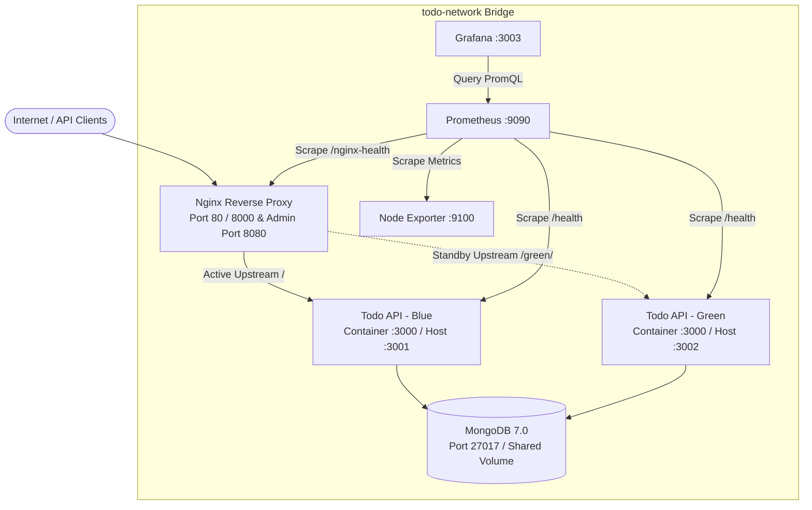

# Blue-Green Deployment Todo API

A production-ready RESTful Todo API engineered for zero-downtime Blue-Green deployments using Node.js, Express, MongoDB, Docker Compose, and Nginx, complete with Terraform cloud provisioning, Ansible configuration management, GitHub Actions & Jenkins CI/CD pipelines, and Prometheus/Grafana observability.

---

## Overview & Key Capabilities

Modern production services require release pipelines that eliminate deployment downtime and allow instant recovery when regressions occur. This repository implements a complete Blue-Green release architecture around a hardened Express + MongoDB REST API:

* **Zero-Downtime Traffic Switching:** Runs two identical production containers (`Blue` on port `3001` and `Green` on port `3002`) behind an Nginx reverse proxy that switches active upstream traffic with a zero-drop reload.
* **Automated Verification & Instant Rollback:** Deployment scripts (`scripts/blue-green-deploy.sh` and `scripts/rollback.sh`) verify container health before shifting traffic and automatically revert to the standby environment if post-switch checks fail.
* **Hardened REST API:** Built with Express 5 and Mongoose 8 featuring `helmet` security headers, IP rate limiting (`express-rate-limit`), strict ObjectId validation, malformed JSON handling, query filtering (`?completed=true|false`), and pagination (`?page=1&limit=10`).
* **End-to-End DevOps Tooling:** Includes multi-environment GitHub Actions workflows, a declarative `Jenkinsfile`, DigitalOcean Terraform modules (`terraform/`), Ansible server playbooks (`ansible/`), an ELK logging stack (`logging/`), Trivy/SonarQube/Vault security configs (`security/`), and automated MongoDB backup/restore scripts (`backup/`).

---

## System Architecture

---

## Technology Stack

| Layer | Technology | Role in Repository |
| :--- | :--- | :--- |
| **Application API** | Node.js 18+, Express 5, Mongoose 8 | RESTful CRUD endpoints, schema validation, rate limiting, and health probes |
| **Database** | MongoDB 7.0 | Shared persistent document store backed by Docker volume `mongodb_data` |
| **Reverse Proxy** | Nginx (`nginx:alpine`) | Upstream load balancing, `/blue/` & `/green/` direct routing, and port `8080` control panel |
| **Containers** | Docker & Docker Compose | Non-root Alpine application image and multi-container local/production orchestration |
| **Infrastructure as Code** | Terraform
